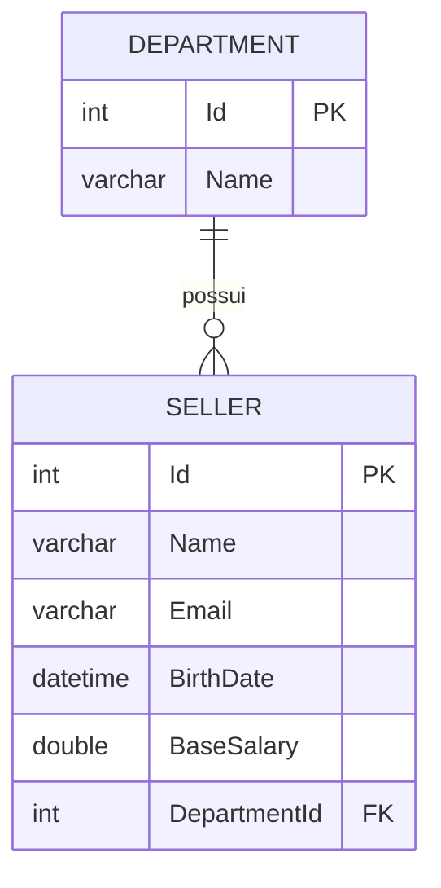

# demo-dao-jdbc

Projeto de estudo em Java que faz o CRUD de vendedores e departamentos em um banco MySQL usando **JDBC** e o **padrão DAO**.

Desenvolvido acompanhando o módulo de JDBC do curso **Java COMPLETO** do professor **Nélio Alves**. Digitei o código
durante as aulas e depois revisei: corrigi um bug no `findAll` de vendedores, tratei o erro de integridade ao excluir
departamento, deixei o `Main` demonstrando todas as operações e tirei a configuração do banco de dentro do repositório.

## O que pratiquei

- **Padrão DAO**: as interfaces `SellerDao` e `DepartmentDao` dizem *o que* pode ser feito; as classes em `model.dao.impl` dizem *como* (com JDBC).
- **Factory**: o `DaoFactory` entrega as implementações, e o programa só conhece as interfaces.
- **JDBC com `PreparedStatement`**: consultas com parâmetros `?`, o que evita SQL injection.
- **`ResultSet` → objetos**: `INNER JOIN` entre `seller` e `department`, usando um `Map` para reaproveitar o mesmo objeto `Department` em vez de criar um por linha.
- **Chave gerada no insert** com `Statement.RETURN_GENERATED_KEYS`.
- **Exceções personalizadas**: `DbException` para falhas de acesso e `DbIntegrityException` quando um departamento ainda tem vendedores (chave estrangeira).
- **Configuração fora do código**: usuário, senha e URL ficam em `db.properties`, que não vai para o Git.

## Modelo de dados



## Estrutura

```
src/
├── application/Main.java          # demonstra todas as operações
├── db/                            # conexão (DB) e exceções
└── model/
    ├── entities/                  # Seller, Department
    └── dao/
        ├── SellerDao.java         # interfaces
        ├── DepartmentDao.java
        ├── DaoFactory.java
        └── impl/                  # SellerDaoJDBC, DepartmentDaoJDBC
database/coursejdbc.sql            # cria o banco com dados de exemplo
db.properties.example              # modelo da configuração
```

## Como rodar

**Pré-requisitos:** JDK 17 ou superior (desenvolvido com o JDK 26), MySQL 8 e o driver [MySQL Connector/J](https://dev.mysql.com/downloads/connector/j/).

1. Crie o banco com os dados de exemplo:
   ```bash
   mysql -u root -p < database/coursejdbc.sql
   ```
2. Copie `db.properties.example` para `db.properties` e coloque seu usuário e senha do MySQL.
3. No IntelliJ: abra a pasta do projeto, adicione o `.jar` do Connector/J em *File → Project Structure → Libraries* e rode `application.Main`.

Ou pelo terminal, na pasta do projeto (no Linux/macOS troque o `;` por `:` no classpath):

```bash
javac -d out -cp caminho/mysql-connector-j.jar $(find src -name "*.java")
java -cp "out;caminho/mysql-connector-j.jar" application.Main
```

O `Main` faz as consultas e depois insere, altera e exclui um departamento e um vendedor temporários,
então o banco termina do mesmo jeito que começou.

## Próximos passos

- Transações com `commit`/`rollback`
- Testes automatizados com JUnit
- Refazer o projeto com Spring Boot e JPA

## Autor

**Ruan Lopes** — estudante de Análise e Desenvolvimento de Sistemas (UNINTER), estudando Java.

[LinkedIn](https://www.linkedin.com/in/ruan-lopes-8556573b0) · [GitHub](https://github.com/RuanLopes427) · [Portfólio](https://ruanlopes427.github.io/portfolio/)
